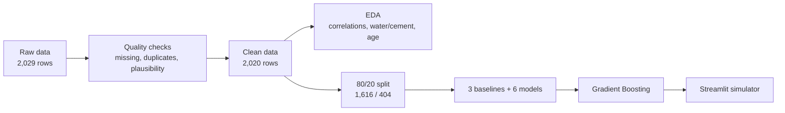
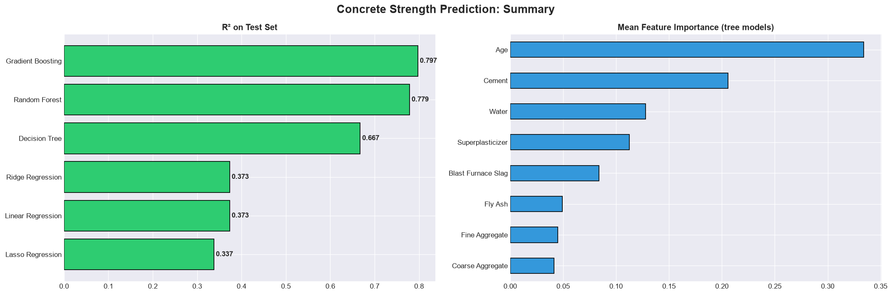
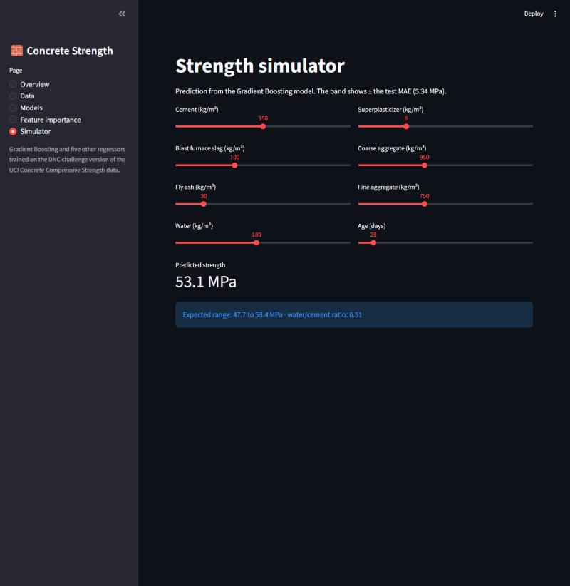

<div align="center">

# 🧱 Concrete Strength Prediction with Machine Learning

**Predicting concrete compressive strength from the mix design, with a model benchmark and an interactive simulator**


[](https://colab.research.google.com/github/Laurentius96/Regression_Applied_to_Materials_Engineering/blob/main/notebooks/concrete_strength_analysis.ipynb)

<p>
  <a href="#-overview">Overview</a> •
  <a href="#-dataset">Dataset</a> •
  <a href="#-pipeline">Pipeline</a> •
  <a href="#-results">Results</a> •
  <a href="#-engineering-insights">Insights</a> •
  <a href="#-streamlit-simulator">Simulator</a> •
  <a href="#-how-to-use">How to Use</a> •
  <a href="#-limitations-and-next-steps">Limitations</a> •
  <a href="#-license">License</a>
</p>

</div>

---

## 🔍 Overview

Compressive strength is the main acceptance criterion for concrete, but it is only known after days or weeks of curing. This project predicts it from the **mix design** (cement, slag, fly ash, water, superplasticizer, aggregates) and the **age** of the sample, compares six regression models against simple baselines and ships the best one in a **Streamlit simulator**.

| | |
|---|---:|
| 🏆 Best model | **Gradient Boosting** |
| 📈 R² on the test set | **0.797** |
| 🎯 MAE / RMSE | **5.34 MPa / 7.44 MPa** |
| 📉 Error cut vs. best baseline | **59%** (MAE 12.93 → 5.34 MPa) |

> Built as a DNC School Data Science challenge. It also draws on my background in Production Engineering.

## 📊 Dataset

[`dataset/concrete_data.csv`](dataset/concrete_data.csv) is the challenge version of the [Concrete Compressive Strength](https://archive.ics.uci.edu/dataset/165/concrete+compressive+strength) data (UCI Machine Learning Repository): **2,029 rows**, 8 features and the target.

| Column | Unit | Description |
|---|---|---|
| `Cement`, `Blast Furnace Slag`, `Fly Ash`, `Water`, `Superplasticizer`, `Coarse Aggregate`, `Fine Aggregate` | kg/m³ | Mix components |
| `Age` | days | Curing time when tested |
| `Concrete compressive strength` | MPa | **Target** |
| `Strength Category` | — | High (≥ 60 MPa) or Low (< 60 MPa) |

<details>
<summary><b>⚠️ Data-quality findings, including a physical plausibility check</b></summary>
<br>

| Finding | Value |
|---|---|
| Missing target values | 9 rows (0.44%), dropped |
| Exact duplicate rows | 25 (1.23%), kept as repeated lab tests |
| Strength categories | 1,831 Low and 189 High |
| **Physically implausible rows** | **992** |

A cubic metre of normal concrete weighs roughly 2,200–2,500 kg, so the components per m³ should add up to that range:

| Rows | Count | Median total mass | Non-integer ages | Mean strength |
|---|---:|---:|---:|---:|
| Plausible | 1,037 | 2,350 kg/m³ | 1% | 35.8 MPa |
| Implausible | 992 | 4,601 kg/m³ | 74% | 36.0 MPa |

The original UCI dataset has **1,030 rows**. In the challenge file, almost all implausible rows come **after row 1,030**: they have about **twice the component mass**, mostly **non-integer ages** and the **same strength**, so they look like synthetic rows appended to the original data. They were kept for modeling, as the challenge requires, and are discussed in the [limitations](#-limitations-and-next-steps).

</details>

## 🔄 Pipeline



## 📈 Results

All metrics on the **test set** (404 rows). Linear models use standardized features; tree models use raw features.

| Model | R² | RMSE (MPa) | MAE (MPa) | R² gap train − test |
|---|---:|---:|---:|---:|
| 🥇 **Gradient Boosting** | **0.7971** | **7.44** | **5.34** | 0.14 |
| 🥈 Random Forest | 0.7786 | 7.78 | 5.48 | 0.19 |
| 🥉 Decision Tree | 0.6672 | 9.54 | 6.72 | 0.27 |
| Ridge Regression | 0.3731 | 13.09 | 10.37 | 0.01 |
| Linear Regression | 0.3731 | 13.09 | 10.37 | 0.01 |
| Lasso Regression | 0.3375 | 13.45 | 10.77 | 0.01 |
| *Baseline: linear (cement only)* | 0.0901 | 15.77 | 12.93 | 0.02 |
| *Baseline: median* | −0.0001 | 16.53 | 13.40 | — |
| *Baseline: mean* | −0.0020 | 16.55 | 13.50 | — |

<div align="center">
  
</div>

**Feature importance** (mean of the three tree models): Age **33.4%** · Cement **20.6%** · Water **12.8%** · Superplasticizer **11.2%** · Blast Furnace Slag 8.4% · Fly Ash 4.9% · Fine Aggregate 4.5% · Coarse Aggregate 4.2%.

## 🧪 Engineering Insights

| Topic | Finding |
|---|---|
| 💧 Water/cement ratio | High-strength mixes have a **45% lower** water/cement ratio (0.44 vs. 0.80), while absolute water differs by only 9% |
| 🧱 Mix design | High-strength mixes use **51% more cement** and about **twice the superplasticizer** |
| ⏳ Curing | Mean strength: 19.0 MPa at 3 days → 26.1 at 7 days → **36.7 at 28 days** → 50.1 at 56 days |
| 🧪 Testing practice | 28 days is the most tested age (426 samples, 21.1%) |
| 📊 Linear vs. trees | Linear models stop at R² ≈ 0.37: the relationships are non-linear and water and the aggregates are correlated (r up to 0.60) |

## 🎮 Streamlit Simulator

<div align="center">
  
</div>

The app in [`notebooks/concrete_dashboard/`](notebooks/concrete_dashboard) has five pages: **Overview**, **Data**, **Models**, **Feature importance** and the **Simulator**, where sliders set the mix and the Gradient Boosting model predicts the strength with a ± MAE band and the water/cement ratio.

## 📁 Project Structure

```
📁 Regression_Applied_to_Materials_Engineering/
├── 📁 dataset/
│   └── 📄 concrete_data.csv                  # Challenge data (2,029 rows)
├── 📁 notebooks/
│   ├── 📓 concrete_strength_analysis.ipynb   # Full analysis with outputs
│   ├── 📁 concrete_dashboard/
│   │   ├── 🐍 app.py                          # Streamlit app
│   │   ├── 📦 dashboard_data.pkl              # Data and results for the app
│   │   └── 📦 models.pkl                      # Trained models for the app
│   └── 📁 concrete_models/
│       ├── 📦 concrete_strength_model.pkl     # Best model (Gradient Boosting)
│       ├── 📦 concrete_scaler.pkl             # StandardScaler for the linear models
│       ├── 📄 concrete_project_report.txt     # Text report with all metrics
│       └── 🖼️ concrete_project_summary.png
├── 📁 assets/
│   └── 🖼️ simulator_preview.jpg
├── 📄 requirements.txt
├── 📄 LICENSE.md                              # CC BY-NC-ND 4.0
└── 📄 README.md
```

## 🚀 How to Use

1. **Clone and install**

   ```bash
   git clone https://github.com/Laurentius96/Regression_Applied_to_Materials_Engineering.git
   cd Regression_Applied_to_Materials_Engineering
   pip install -r requirements.txt
   ```

2. **Run the notebook** from the `notebooks/` folder (paths are relative to it). It also regenerates the files used by the app.

   ```bash
   cd notebooks
   jupyter notebook concrete_strength_analysis.ipynb
   ```

3. **Launch the simulator**

   ```bash
   cd concrete_dashboard
   streamlit run app.py
   ```

> 💡 The `.pkl` files were created with scikit-learn 1.9. If your version differs and loading fails, run the notebook once to rebuild them.

## 🧭 Limitations and Next Steps

**Limitations**
- About half of the challenge data (992 rows) is physically implausible; keeping it probably limits the model.
- The Random Forest overfits the most (R² gap 0.19), and no hyperparameter tuning or cross-validation was done.
- The ± MAE band is an average error, not a statistical prediction interval.

**Next steps**
- [ ] Retrain on the 1,037 plausible rows and compare the metrics
- [ ] Tune hyperparameters with cross-validation
- [ ] Add the water/cement ratio as an engineered feature

## 🤝 Contributing

Contributions, ideas and feedback are welcome!

- 🐛 **Found a bug or something unclear?** [Open an issue](https://github.com/Laurentius96/Regression_Applied_to_Materials_Engineering/issues/new) describing what happened and how to reproduce it.
- 💡 **Have an idea or a question?** [Open an issue](https://github.com/Laurentius96/Regression_Applied_to_Materials_Engineering/issues/new) and tell me about it.
- 🔧 **Want to propose a fix?** Fork the repository, create a branch (`git checkout -b fix/short-description`), commit your changes and open a pull request explaining what changed and why.

By contributing, you agree that your contribution is shared under the same license as this project.

## 📜 License

This project is licensed under the [Creative Commons Attribution-NonCommercial-NoDerivatives 4.0 International License (CC BY-NC-ND 4.0)](LICENSE.md).

**What this means:**
- ✅ You may **share** this work with **attribution**
- ❌ You may **not** use it for **commercial purposes**
- ❌ You may **not** distribute **modified versions**

## 🙏 Acknowledgments

- [DNC School](https://www.escoladnc.com.br/) for the challenge
- I-Cheng Yeh for the original [Concrete Compressive Strength](https://archive.ics.uci.edu/dataset/165/concrete+compressive+strength) dataset (UCI Machine Learning Repository)

---

<div align="center">

**Lorenzo C. Bianchi** · [GitHub](https://github.com/Laurentius96) · [LinkedIn](https://www.linkedin.com/in/cb-lorenzo/)

</div>
